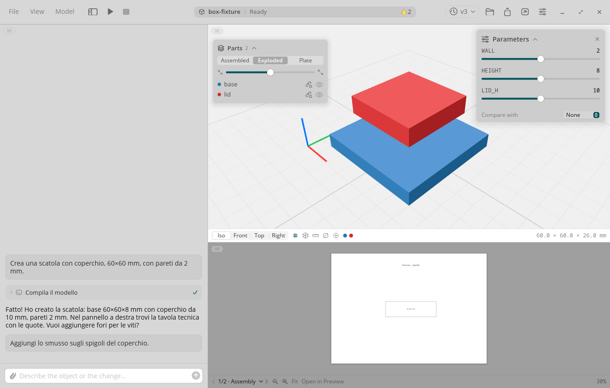
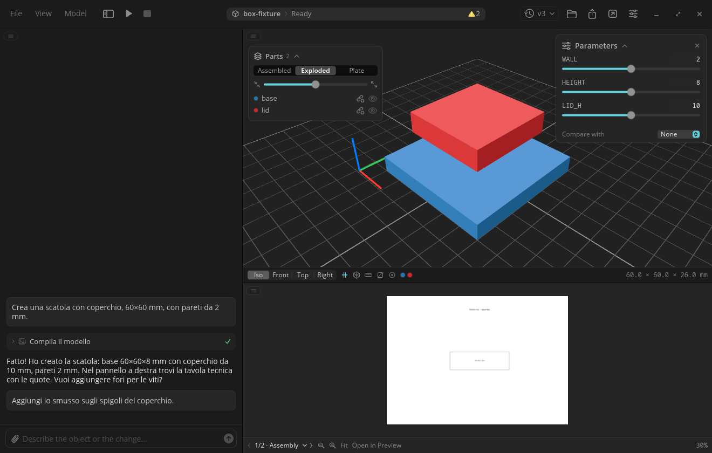
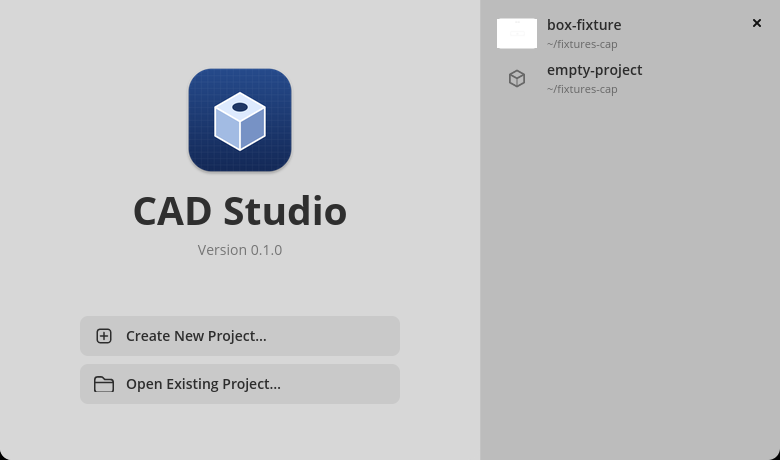

# CAD Studio for COSMIC

Describe a part, get a printable model. CAD Studio is a Rust port of
[cad-studio](https://github.com/filippofinke/cad-studio) for the
[COSMIC desktop](https://system76.com/cosmic). You chat with your locally
installed Claude Code (or Codex). The agent writes a parametric
[build123d](https://build123d.readthedocs.io) `model.py`, the app runs it,
renders the result in 3D, shows the technical drawings, and hands the print
plate to your slicer.





## Features

- Chat with Claude Code or Codex. Agent progress, tool calls and thinking
  stream into the chat as they happen. Prompts sent while a turn runs queue up.
- 3D viewer on the GPU (wgpu): orbit, pan, zoom, view presets, measure, section
  cut, exploded parts, and a print-plate layout.
- Animation playback for models that ship an `animation.json` study.
- Parameter sliders. Moving one rewrites the value in `model.py` and rebuilds
  directly, without the agent.
- ISO technical drawings beside the model.
- Version history. Each successful turn or build is a version. Restore any
  version, or compare one against the current model.
- Attachments on prompts.
- ZIP export of the printable files, and open-in-slicer for the plate.
- Printer-aware rules: the printer type and model you set are passed to the
  agent.
- Panel layouts for the chat, model and drawing panes.
- Follows the COSMIC theme: light or dark, accent color, fonts, corner radii and
  text scale.
- English, Italian, German and French. See Usage for choosing the language.

Project folders use upstream's on-disk formats, so a project opens in either
the macOS app or this one.

## Requirements

- A COSMIC desktop session on Linux.
- A Rust toolchain (to build) and [`just`](https://github.com/casey/just) (to
  install).
- Claude Code or Codex, installed and logged in (`claude`, or `codex login`).
- `uv` is recommended. The app uses it to create its build123d virtual
  environment. Without `uv` it falls back to a Python 3.10 to 3.13 interpreter
  with `venv`.
- `/usr/bin/zip`, for the ZIP export.

## Install

```bash
just install      # build release, install into ~/.local
just uninstall    # remove exactly what install laid down
```

`just install` puts the binary in `~/.local/bin`, and the desktop entry,
metainfo and hicolor icons under `~/.local/share`. The app then appears in the
COSMIC app grid. `just install dev` installs the debug build instead.

## First run

1. A setup sheet asks for your printer type and model. Continue to proceed.
2. The app looks for `claude` (or `codex`). If it finds neither, a sheet says
   so and points at Settings > Agent.
3. The app checks for its build123d environment. If it is missing, the Python
   sheet installs it. This takes a minute or two the first time.
4. The welcome window offers Create New Project and Open Existing Project.
   Recent projects are listed on the right.



## Usage

- **Prompt.** Type in the chat box and press Return. The agent writes
  `model.py` and builds it. The model and drawings appear when the build
  finishes.
- **Sliders.** The Parameters card lists the numeric parameters the model
  declares. Dragging one rebuilds the model without a new turn.
- **Versions.** The clock button in the toolbar lists versions. Choose one to
  restore it. Set Compare with in the Parameters card to see two versions
  together.
- **Viewer tools.** The bar under the model has view presets, the grid, measure,
  section, and animation toggles. The Parts card switches between Assembled,
  Exploded and Plate.
- **Export.** The share button writes a ZIP of the printable files. The
  slicer button opens the plate (or the model) in the application your desktop
  associates with 3MF files.
- **Language.** Settings > General has a language picker: System, Italiano,
  English, Deutsch, Français. The change applies on the next launch. System
  follows the desktop language and falls back to English.

## Troubleshooting

**Agent not found.** The app searches your `PATH` and the usual install
directories for `claude` or `codex`. If yours lives elsewhere, set the
executable path in Settings > Agent and press Check. Make sure you are logged
in: run `claude` once in a terminal, or `codex login`.

**Python setup failed.** The Python sheet shows the failure message; Show Details reveals the installer log. Install
`uv`, or a Python 3.10 to 3.13 with the `venv` module, and use Reinstall in
Settings > Python.

**Where things live.**

| What | Where |
|---|---|
| App settings | `~/.config/cad-studio/settings.json` |
| build123d environment, process registry | `~/.local/share/cad-studio/` (`venv/` inside) |
| Window and pane state | COSMIC config, `net.brownhouse.CadStudio` |
| Per-project agent logs | `<project>/.cadstudio/logs/` |

If `settings.json` cannot be parsed, the app reads defaults and refuses to
write over the file until you fix it. The reason is logged to the terminal the
app was started from.

## Development

Builds and tests run on the rig or on thelio, not on a laptop. The rig is an
incus container with Xvfb and software Vulkan and GL; see
[scripts/rig/README.md](scripts/rig/README.md). On either machine:

```bash
cargo test --workspace
just run              # the app, from a terminal inside a COSMIC session
just headless         # viewer GPU render tests
```

Two tools drive and photograph the UI without input events:

- The drive harness. Set `CAD_STUDIO_DRIVE` to a script file and the app plays
  it as a stream of app messages. See [app/src/drive.rs](app/src/drive.rs) for
  the command list and `scripts/rig/shots/*.drive` for examples.
- `scripts/rig/capall.sh` captures every shot in a spec file, each in its own
  Xvfb, from a drive script. `scripts/rig/pairs.sh` places each capture beside
  its upstream gallery image.

Design and internals: [docs/architecture.md](docs/architecture.md). The port
design spec is
[docs/superpowers/specs/2026-10-11-cad-studio-cosmic-port-design.md](docs/superpowers/specs/2026-10-11-cad-studio-cosmic-port-design.md),
and research notes are under [docs/research/](docs/research/).

## License

MIT. See [LICENSE](LICENSE). This is a port of Filippo Finke's MIT-licensed
[cad-studio](https://github.com/filippofinke/cad-studio); his copyright is
kept, with the port's copyright added.

Not affiliated with Anthropic.
